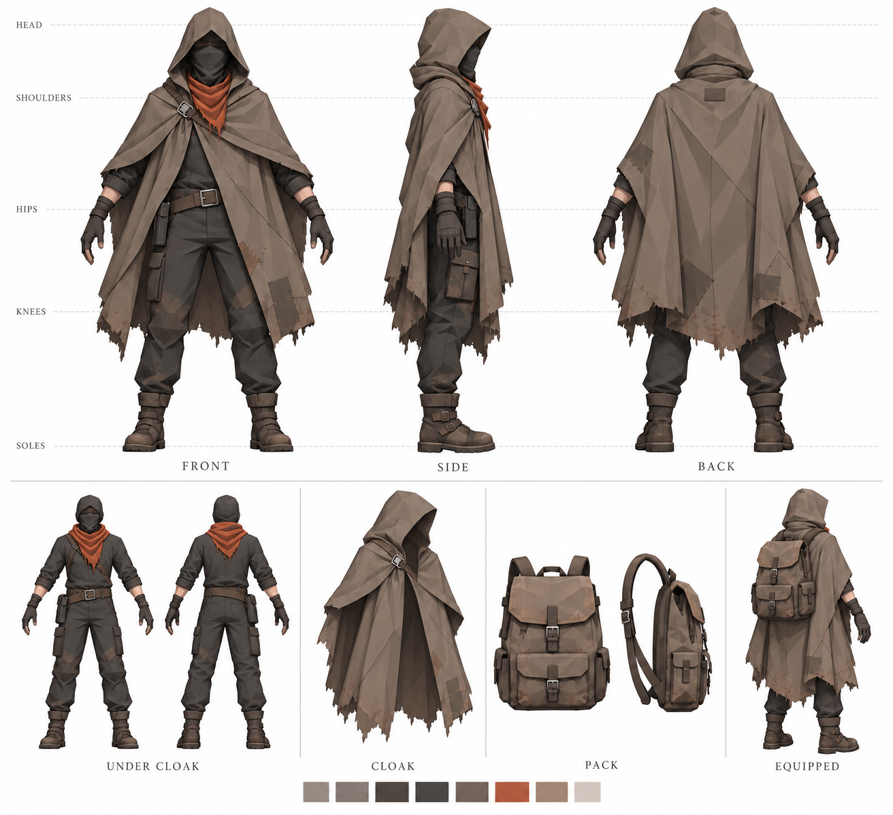
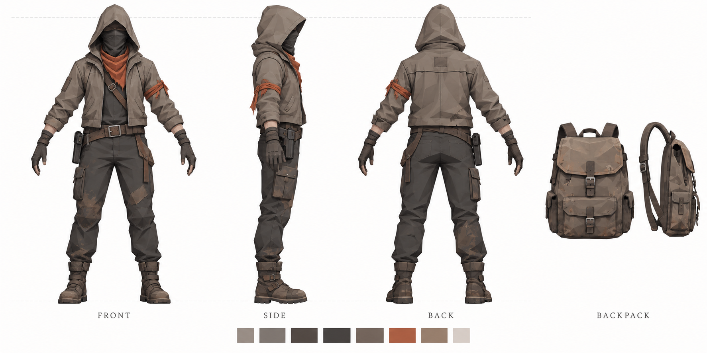

# Player 外形设定：寻火者

更新日期：2026-10-27

## 当前方向

玩家角色是一名在黑暗废土中搜集物资、追寻圣火的寻火者。

主创明确的外形要求：**遮住面部、弱化性别，并具有明显的斗篷效果。**

当前视觉参考采用斗篷版 v2。它是待继续细化的概念参考，不等于已完成的建模规范或 Unity 角色资产。

## 当前概念图中的设计

| 部位 | 设计说明 |
| --- | --- |
| 头部 | 深兜帽配布质面罩，隐藏面部特征。 |
| 体型 | 中性成人比例，避免突出性别特征。 |
| 斗篷 | 灰褐色兜帽斗篷覆盖肩背，下摆接近膝部；前方开口，露出手臂及腿部。 |
| 材质 | 旧布料，有适量磨损、补丁和破损边缘，表现长期旅行与物资匮乏。 |
| 内搭 | 深色实用衣裤、腰带、手套和厚实靴子。 |
| 识别色 | 暗橙色围巾／布饰，与灰褐色和炭灰色主体形成区分。 |
| 装备 | 小型手枪枪套、帆布背包；背包在参考图中独立展示。 |
| 美术表现 | 低多边形风格、清晰的大块轮廓和简化明暗，适配游戏斜俯视镜头。 |

以上具体长度、配色、配饰和磨损程度来自当前生成方案，可随主创反馈调整。

## 当前三视图：斗篷版 v2

文件：`寻火者_斗篷三视图_v2.png`

包括正面、侧面、背面，以及独立背包参考。主视图不佩戴背包，以便查看斗篷结构。

## 建模补充参考 v3

文件：`寻火者_建模参考_v3.png`

沿用 v2 斗篷方向，补充比例对齐的三视图、去除斗篷后的内搭正背面、独立斗篷、背包及背包佩戴效果，供 Claude 制作模型时参考。背包佩戴在斗篷外侧为本图提出的方案，尚需主创确认。局部结构仍须在建模时统一，以主体三视图为主要依据。

生成方式：内置图像编辑，以 v2 为参考。提示词要点：保持遮脸中性寻火者身份及灰褐色及膝斗篷，提供正交三视图与服装装备拆分，简化为适合斜俯视低多边形游戏的大块结构，白底清晰标注。

## 历史方案：短外套版 v1

文件：`寻火者_角色三视图_v1.png`

保留作为造型迭代记录。当前以斗篷方向继续设计，不以短外套作为主体轮廓。

## 后续建模与接入说明

- 两张图片均为 AI 生成的外观参考，不包含模型、骨骼、动画或分层 PSD。
- 建模前统一三面中的接缝、扣具、枪套位置和斗篷下摆结构，不能把生成图中的局部差异直接做进模型。
- 背包实际佩戴时与斗篷的关系尚未确定，需要补充佩戴参考。
- 斗篷需适配持枪、行走、跑步和翻滚，具体分片、骨骼与摆动方式在制作阶段确定。
- 在实际游戏镜头下检查角色辨识度、斗篷遮挡与动作穿插。
- 本文只记录外形，不改变现有玩法，不新增角色随身安全光或兽化系统。
